# Horyzont

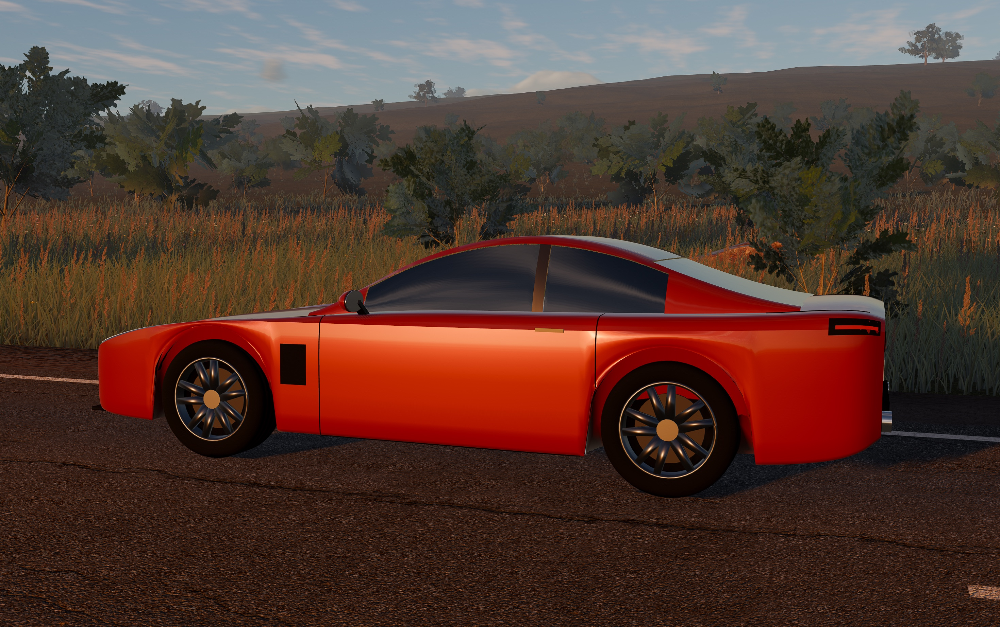

Spokojny road trip po wyspie na Atlantyku. Jeździsz krętą drogą wzdłuż klifów, plaż i
przełęczy, czekasz na idealne światło i robisz zdjęcia-pocztówki. Niebo, chmury, pogoda,
teren, auto i dźwięk są w całości proceduralne (Godot 4.7, Metal).

## Ujęcia
Statyczna scena: auto stoi, a obraz ma czas się ustabilizować. Preset Ultra w pełnej rozdzielczości (2940×1846), klatki z gry bez retuszu.

| | |
|---|---|
| 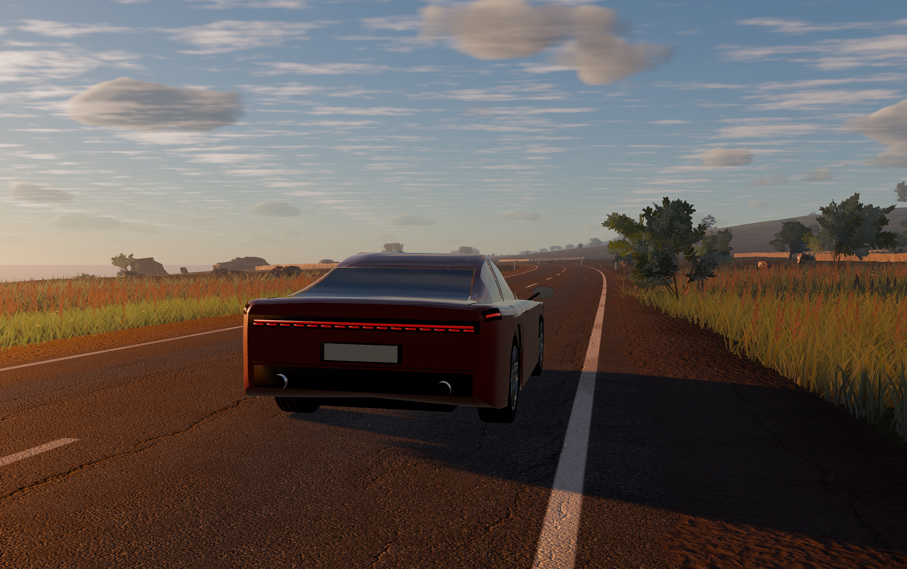 | 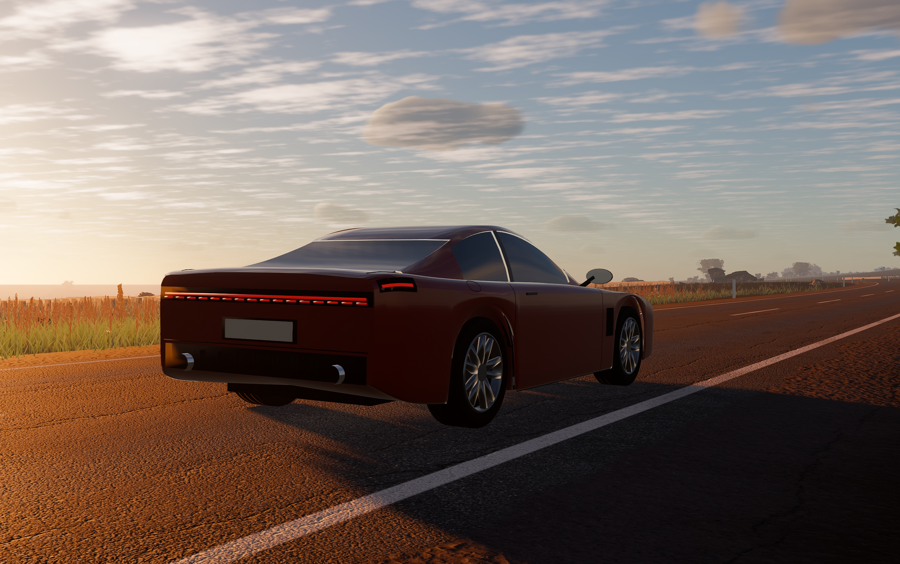 |
| 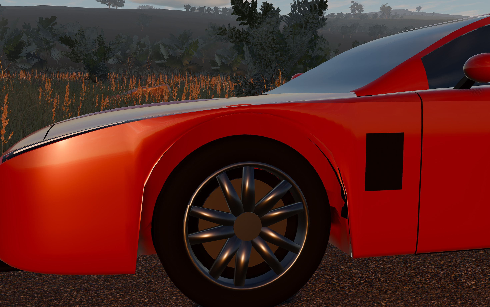 | 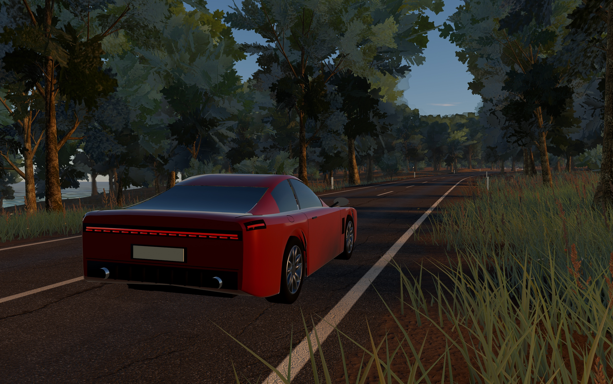 |
| 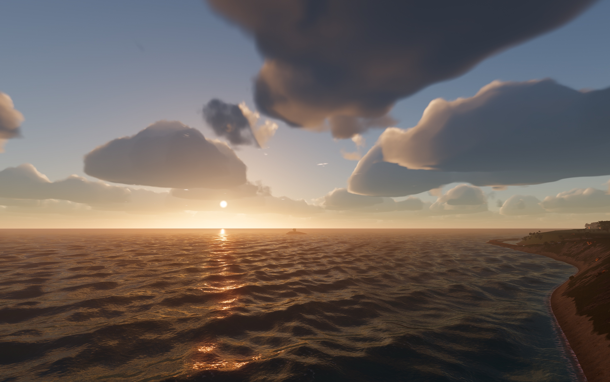 | 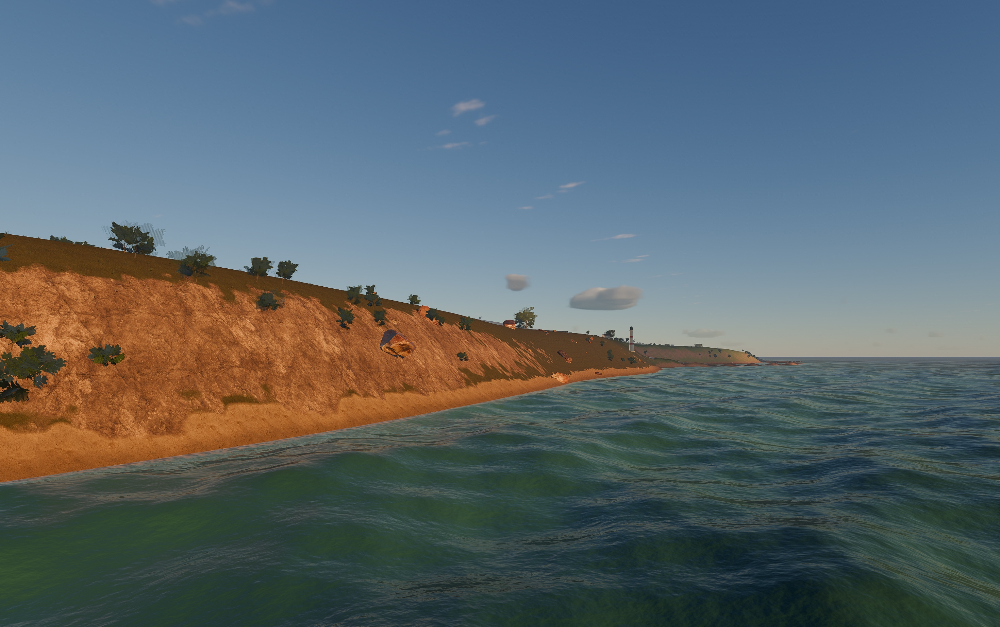 |
| 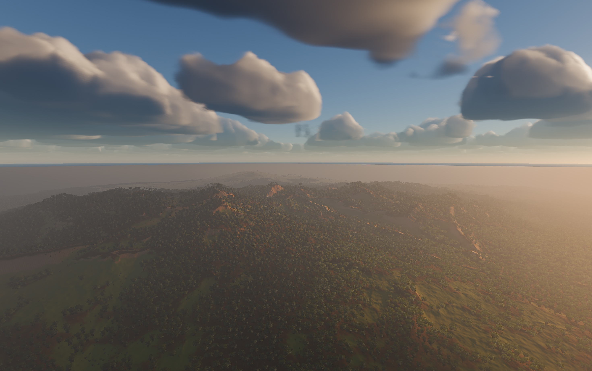 | 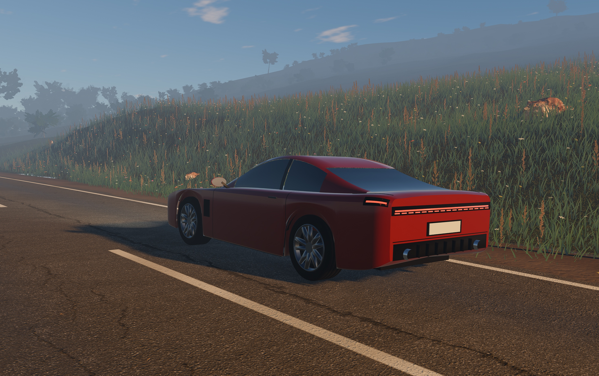 |
| 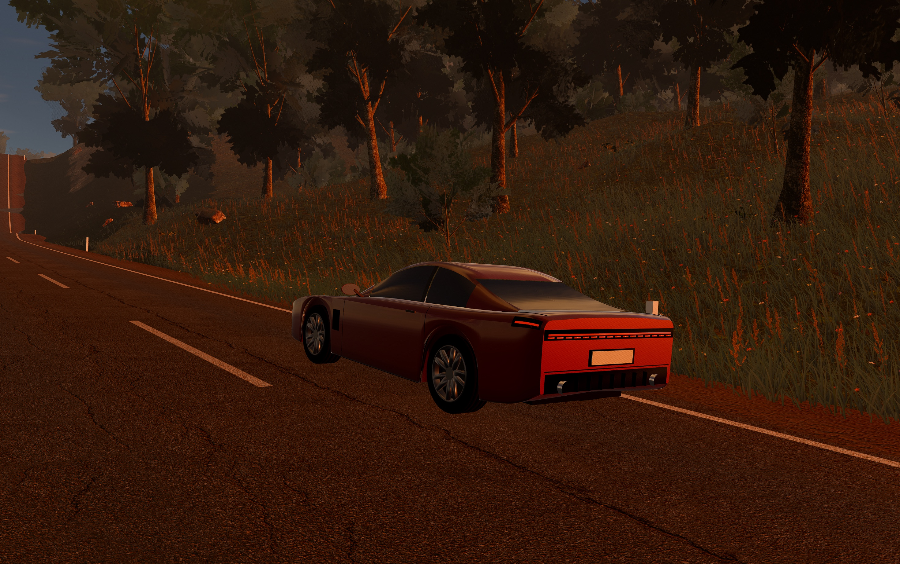 | 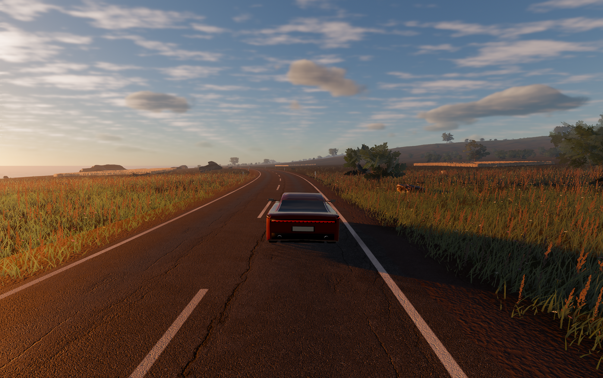 |

## Jak to działa
Świat powstaje w kodzie: około 10 tys. linii GDScript i 2,5 tys. linii shaderów. Z zewnątrz pochodzą tylko zasoby CC0, czyli tekstury oraz skany liści, głazów i pni.

| Element | Rozwiązanie |
|---|---|
| Silnik | Godot 4.7, Forward+, Metal, Jolt (fizyka 120 Hz), MetalFX Temporal z 58% rozdzielczości |
| Atmosfera | model Hillaire 2020 w LUT-ach HDR, pełny cykl dnia z krzywą ekspozycji |
| Chmury | wolumetryczne (Schneider) i cirrusy, liczone w połowie rozdzielczości z historią i reprojekcją po obrocie kamery, mapa cieni chmur 256² na 8 km |
| Teren | heightmapa 4096² (2,5 m/texel, 10,24 km) wypiekana na GPU, clipmapa 7 poziomów, 6 materiałów 4K, mapa ekosystemu 4096², droga około 23 km wcinana w teren |
| Ocean | clipmapa 9 poziomów, 5 fal Gerstnera, kolor i piana z głębokości odczytanej z heightmapy |
| Trawa | kafle źdźbeł z 3 LOD, pozycje w teksturze-tabeli czytanej po `INSTANCE_ID`, dzięki czemu motion vectors dla upscalera zostają poprawne |
| Las | 143 tys. drzew i krzewów z generatora gałęzi (5 gatunków), LOD0, LOD1 i impostory z 8 widoków wypiekane przy starcie |
| Auto | raycast vehicle na 4 promieniach, proceduralna karoseria z przekrojów, autopilot i 5 ujęć kinowych |

## Uruchomienie
Wymaga Godota 4.7 (Forward+). Gra powstała i była testowana na macOS z Metal. Po sklonowaniu raz zaimportuj zasoby:
```bash
godot --headless --path . --import
```
Potem dwuklik `Horyzont.command` albo:
```bash
godot --path .
```

## Wydajność
MacBook Air M4, 2940×1658, render w 58% rozdzielczości i MetalFX. Pełny ekran jest o około 1 ms na klatkę wolniejszy.

| Preset | Otwarta trasa | Las |
|---|---|---|
| Wysoka | 46 fps | 40 fps |
| Średnia | 65 fps | 54 fps |
| Niska | 78 fps | 60 fps |

## Sterowanie
| Klawisz | Akcja |
|---|---|
| W / S lub strzałki | gaz / hamulec (przytrzymaj S na postoju = wsteczny) |
| A / D | skręt |
| Spacja | ręczny |
| C | zmiana kamery (pościg, daleko, maska) |
| K | tryb Kino (autopilot + filmowe ujęcia) |
| T (przytrzymaj) | przyspieszenie czasu — czekanie na zachód słońca |
| F | zdjęcie (pocztówka, jeśli jesteś w miejscu i światło się zgadza) |
| Tab | następna pocztówka |
| P | tryb foto (wolna kamera: WASD, Q/E góra-dół, Shift szybciej, Spacja zdjęcie; pełna rozdzielczość ekranu) |
| L | światła ręcznie (domyślnie same się włączają o zmroku) |
| R | powrót na drogę |
| H | ukryj HUD, Esc — pauza (pora dnia, pogoda, tempo czasu) |

## Pocztówki
Dziewięć miejsc na wyspie wymaga konkretnego światła albo pogody, np. złotej godziny na
klifach, niebieskiej godziny albo mgły w dolinie. Na miejsce prowadzi świetlny słup i
kompas w HUD. 3 gwiazdki dostajesz, gdy warunki się zgadzają, a słońce jest w kadrze.
Zdjęcia trafiają do albumu (menu → Album).

## Zasoby
Tekstury, liście i modele są na licencji CC0, źródła w [assets/CREDITS.md](assets/CREDITS.md).
